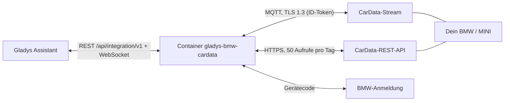
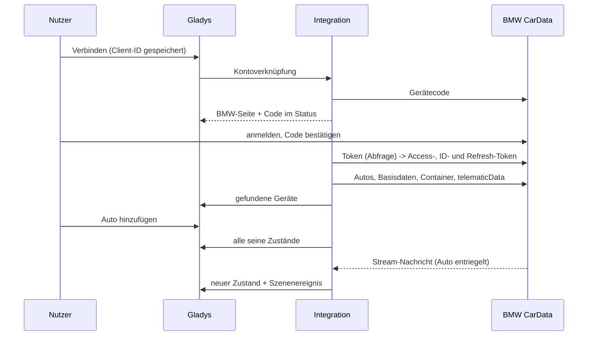
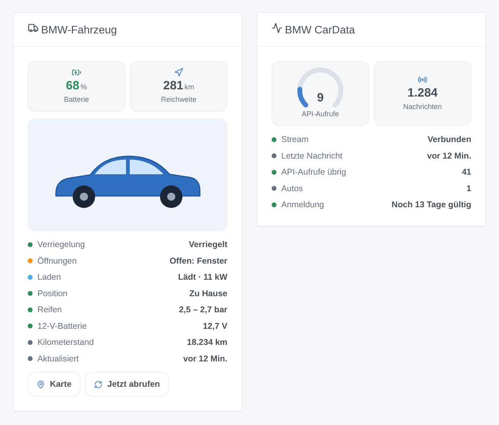

# Gladys BMW CarData

[English](README.md) · [Français](README.fr.md) · **Deutsch** · [Español](README.es.md)

[](LICENSE)
[](https://github.com/William-De71/gladys-bmw-cardata/releases)
[](https://github.com/William-De71/gladys-bmw-cardata/actions/workflows/release.yml)
[](https://gladysassistant.com)


Externe [Gladys-Assistant](https://gladysassistant.com)-Integration für **BMW- und MINI-Fahrzeuge** über **BMW CarData**, den offiziellen, nur lesenden Zugang von BMW zu den Daten deines eigenen Autos (Europa). Batterie, Reichweite, Laden, Türen, Verriegelung, Reifen und Position kommen in Sekunden über den CarData-Stream an, ergänzt durch die REST-API im Rahmen ihrer 50 Aufrufe pro Tag.

Benutzerdokumentation: [English](docs/en.md) · [Français](docs/fr.md) · [Deutsch](docs/de.md) · [Español](docs/es.md).

> Community-Integration, nicht mit BMW Group verbunden und nicht von ihr unterstützt.

## Funktionen

- Ein **Gerät pro Auto**: Batterie, elektrische und Gesamtreichweite, Kraftstoff, Ladekabel, Ladestatus und -leistung, Ladeziel, Restzeit, Kilometerstand, Verriegelung, Türen, Kofferraum, Motorhaube, Fenster, Schiebedach, in Fahrt, Vorklimatisierung, Reifendrücke, Entfernung von zu Hause.
- **Echtzeit** über den MQTT-Stream von CarData und **REST-API** mit Kontingentzähler (50 Aufrufe pro Tag für das Konto, 5 für deine Anfragen reserviert).
- **7 Szenenauslöser**, **1 Szenenaktion** und **2 Dashboard-Widgets** (unten).
- **Nur lesend**: CarData nimmt keine Befehle an (keine Verriegelung, Klimatisierung oder Ladesteuerung).
- Vier Sprachen überall: Englisch, Französisch, Deutsch, Spanisch.

## Funktionsweise






### Transport

`transports: ["cloud"]`: Alle Werte kommen von den BMW-Servern. Die Autos tragen das Cloud-Abzeichen; solange der Stream getrennt ist, zeigt das Abzeichen einen orangen Punkt (eingeschränkter Modus: Werte nur über die API).

## Geräte und Funktionen

| Funktion                                       | Kategorie / Typ                                                                        | Quelle                                                      |
| ---------------------------------------------- | -------------------------------------------------------------------------------------- | ----------------------------------------------------------- |
| Batterie (%)                                   | `electrical-vehicle-battery` / `battery-level`                                         | `batteryManagement.header` oder `stateOfCharge.displayed`   |
| Elektrische, Gesamtreichweite (km)             | `electrical-vehicle-battery` / `battery-range-estimate`, `distance-sensor` / `decimal` | `remainingElectricRange`, `totalRemainingRange`             |
| Tankfüllstand (%), Kraftstoff (L)              | `level-sensor` / `liquid-level-percent`, `volume-sensor` / `decimal`                   | `fuelSystem.level`, `fuelSystem.remainingFuel`              |
| Kabel, lädt, Status, Leistung, Ziel, Restzeit  | `electrical-vehicle-charge`, `text`, `duration`                                        | `chargingPort.status`, `charging.status`, `charging.power`… |
| Kilometerstand                                 | `electrical-vehicle-state` / `odometer`                                                | `vehicle.travelledDistance`                                 |
| Verriegelt                                     | `electrical-vehicle-command` / `lock` (nur lesend)                                     | `cabin.door.status`, `cabin.door.lock.status`               |
| Türen, Kofferraum, Haube, Fenster, Schiebedach | `electrical-vehicle-state` / `door-opened`, `window-opened`                            | Türen, `trunk.isOpen`, `hood.isOpen`, Fenster, Dach         |
| In Fahrt, Vorklimatisierung                    | `motion-sensor` / `binary`, `electrical-vehicle-climate` / `climate-on`                | `vehicle.isMoving`, `preConditioning.activity`              |
| Reifendrücke (bar)                             | `electrical-vehicle-state` / `tire-pressure`                                           | `axle.row*.wheel.*.tire.pressure` (kPa)                     |
| Entfernung von zu Hause (km)                   | `distance-sensor` / `decimal`                                                          | Position und Häuser von Gladys                              |

## Szenenauslöser, -aktionen und Widgets



- Auslöser: verriegelt oder entriegelt, verriegelt aber offen, Ladestatus geändert, Kabel an- oder abgesteckt, losgefahren oder angehalten, zu Hause angekommen oder weg, Anmeldung erneuern.
- Aktion: Status eines Autos lesen (optional nach einem API-Abruf).
- Widgets: **BMW-Fahrzeug** (Bild, Kacheln, Status, Schaltflächen Karte und Jetzt abrufen), **BMW CarData** (API-Aufrufe des Tages, Stream, Anmeldung).
- Beispiele: verriegelt aber offen → Nachricht mit dem, was offen ist; Laden beendet → Benachrichtigung mit dem Batteriestand; nachts zu Hause angekommen → Einfahrtsbeleuchtung an.

Nicht umgesetzt: Befehle (CarData hat keine), die Endpunkte Ladehistorie, Reifendiagnose und ortsbezogene Ladeeinstellungen (jeder kostet Kontingent für wenig Nutzen im Dashboard), die Wartungsliste (CBS).

## Voraussetzungen

- Gladys **5.1.1** oder neuer (ältere Versionen können die Integration nicht installieren: Widgets und Szenen).
- Ein BMW oder MINI in Europa, dessen Hauptnutzer du bist, mit ConnectedDrive.
- Eine CarData-Client-ID mit **beiden** Abos (API und Stream) und einem konfigurierten Datenstream (siehe [Dokumentation](docs/de.md#voraussetzungen)).

## Installation

- **Aus dem Store**: Integrationen → BMW CarData → Installieren.
- **Über die Repository-URL**: Integrationen → Externe Integration hinzufügen → `https://github.com/William-De71/gladys-bmw-cardata`.
- **Entwicklermodus**: `npm install`, dann neben einem Gladys im Entwicklermodus mit den Variablen unten starten.

## Konfiguration

| Feld                     | Standard                                           | Zweck                                               |
| ------------------------ | -------------------------------------------------- | --------------------------------------------------- |
| CarData-Client-ID        | —                                                  | Im CarData-Bereich des MyBMW-/MINI-Portals erstellt |
| BMW-Konto                | —                                                  | Verbinden: BMW-Anmeldung per Gerätecode             |
| Stream-Host / -Port      | `customer.streaming-cardata.bmwgroup.com` / `9000` | Wie im Portal angezeigt                             |
| API-Abruf alle (Stunden) | 4                                                  | 0 = nur auf Anfrage                                 |
| Heimradius (m)           | 200                                                | Zu Hause angekommen / weg                           |
| Sprache der Texte        | Automatisch                                        | Funktionsnamen, Szenenzusammenfassungen             |

Konfigurationsaktionen: **Verbindung testen**, **Autos jetzt abrufen**, **Diagnose** (eine anonymisierte Zusammenfassung im Log), **Trennen**.

## Verwendung

Speichere die Client-ID, klicke auf **Verbinden**, bestätige den Code auf der BMW-Seite und füge das Auto unter **Entdecken** hinzu. Ver- und entriegle es einmal, wenn kein Wert ankommt: Ein schlafendes Auto sendet nichts.

## Entwicklung

```bash
npm install
npm test                     # node --test, nie mit dem Netzwerk
npm run lint && npm run format:check
npx github:GladysAssistant/integration-store . --skip-image-check
docs/illustrations/render.sh # Widget-Illustrationen
scripts/build-cover.sh       # cover.jpg
```

Umgebungsvariablen (vom Gladys-Supervisor gesetzt): `GLADYS_HOST_API_URL`, `GLADYS_INTEGRATION_TOKEN`, `GLADYS_INTEGRATION_SELECTOR`. `CARDATA_DATA_DIR` ändert das Datenverzeichnis (Standard `/data`).

## Release-Prozess


Jeder Merge auf `main` startet die CI und berechnet dann die Version aus den [Conventional Commits](https://www.conventionalcommits.org/) seit dem letzten Tag: `feat` → Minor, `fix` / `perf` → Patch, `!` oder `BREAKING CHANGE` → Major (Minor unter 1.0.0); `docs`, `chore`, `ci`, `test`, `style`, `refactor`, `build` allein veröffentlichen nichts. Der Changelog-Abschnitt wird erzeugt, das Tag gepusht, das Multi-Architektur-Image gebaut, dann erhält `main` den Release-Commit, das GitHub Release wird erstellt und ein letzter Job prüft das öffentliche Image, den Store-Validator und das Topic.

- Der Titel des Pull Requests wird zum Squash-Commit und dann zur Changelog-Zeile: Schreibe ihn auf Englisch, für den Nutzer (`pr-title.yml` prüft ihn). Bearbeite `CHANGELOG.md` nie von Hand.
- 1.0.0 ist eine Entscheidung: Actions → Release → Run workflow mit `release-as: 1.0.0`. `dry-run` zeigt Version und Notizen, ohne zu veröffentlichen.
- **Geschützter Branch**: Das Release pusht seinen Commit mit `GITHUB_TOKEN` auf `main`. Mit einem Ruleset auf `main` füge GitHub Actions zur Bypass-Liste hinzu (oder pushe über eine GitHub App), sonst scheitert der Veröffentlichungsjob.
- Nach dem ersten Release muss das Paket `ghcr.io` öffentlich sein (Package settings → Change visibility).

## Fehlerbehebung

Siehe [docs/de.md](docs/de.md#fehlerbehebung). Melde Probleme mit den Versionen von Gladys und der Integration, dem Automodell und der Ausgabe der Schaltfläche **Diagnose** (Einstellungen → Überwachung).

## Mitwirken

Issues und Pull Requests sind willkommen. Führe `npm run format:check && npm run lint && npm test` aus, bevor du einen Pull Request öffnest, und ändere keine externe ID und keinen gespeicherten Schlüssel (siehe [CLAUDE.md](CLAUDE.md)).

## Sicherheit

Siehe [SECURITY.md](SECURITY.md): Melde Schwachstellen vertraulich. Die Tokens liegen in der Gladys-Konfiguration (außerhalb des Formulars) und werden nie geloggt; FINs werden im Log gekürzt.

## Kommende Screenshots

Die Bilder oben sind Illustrationen, keine Screenshots. Echte Screenshots kommen nach `docs/assets/screenshots/` (PNG, 1280 × 800): `configuration.png`, `sign-in.png`, `discovery.png`, `device.png`.

## Lizenz

[Apache-Lizenz 2.0](LICENSE) — siehe auch [NOTICE](NOTICE). BMW, MINI und CarData sind Marken der BMW AG; diese Community-Integration ist nicht mit ihr verbunden. Danke an die Dokumentation und das SDK von Gladys und an die CarData-Integrationen von Home Assistant, deren Erfahrung diese geprägt hat.
