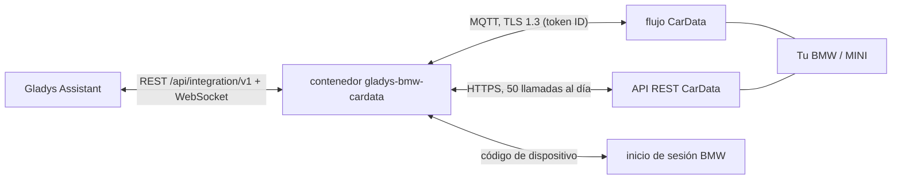
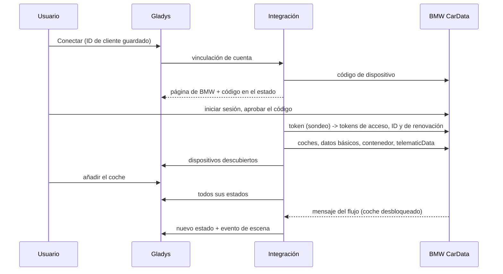
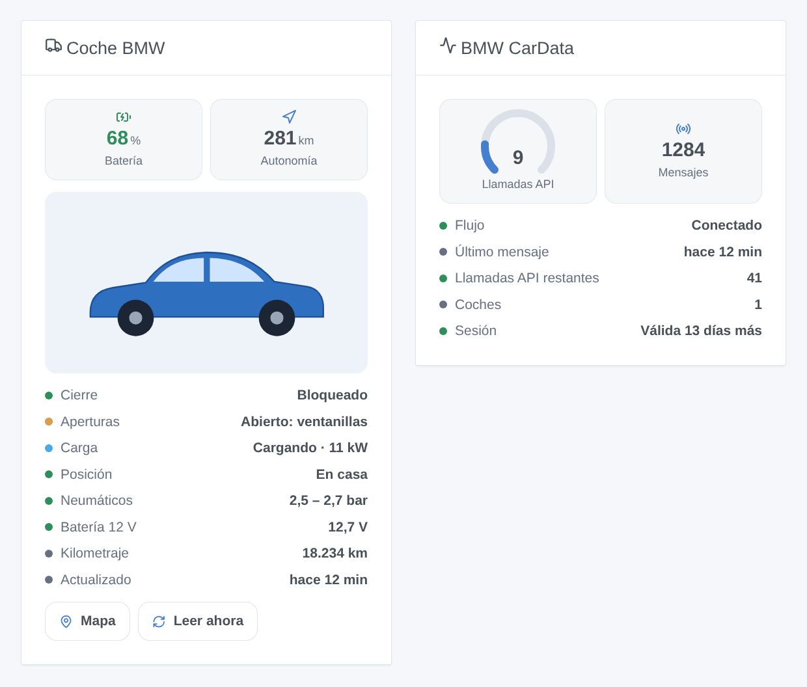

# Gladys BMW CarData

[English](README.md) · [Français](README.fr.md) · [Deutsch](README.de.md) · **Español**

[](LICENSE)
[](https://github.com/William-De71/gladys-bmw-cardata/releases)
[](https://github.com/William-De71/gladys-bmw-cardata/actions/workflows/release.yml)
[](https://gladysassistant.com)


Integración externa de [Gladys Assistant](https://gladysassistant.com) para **coches BMW y MINI**, mediante **BMW CarData**, el acceso oficial y de solo lectura de BMW a los datos de tu propio coche (Europa). Batería, autonomía, carga, puertas, cierre, neumáticos y posición llegan en segundos por el flujo de CarData, completado por la API REST dentro de sus 50 llamadas al día.

Documentación de usuario: [English](docs/en.md) · [Français](docs/fr.md) · [Deutsch](docs/de.md) · [Español](docs/es.md).

> Integración comunitaria, sin vínculo con BMW Group ni respaldada por él.

## Funciones

- Un **dispositivo por coche**: batería, autonomía eléctrica y total, combustible, cable de carga, estado y potencia de carga, objetivo, tiempo restante, kilometraje, cierre, puertas, maletero, capó, ventanillas, techo solar, en marcha, preclimatización, presiones de los neumáticos, distancia de casa.
- **Tiempo real** por el flujo MQTT de CarData y **API REST** con contador de cuota (50 llamadas al día para la cuenta, 5 reservadas para tus peticiones).
- **7 disparadores de escena**, **1 acción de escena** y **2 widgets** (abajo).
- **Solo lectura**: CarData no acepta comandos (ni cierre, ni climatización, ni control de la carga).
- Cuatro idiomas en todas partes: inglés, francés, alemán y español.

## Funcionamiento






### Transporte

`transports: ["cloud"]`: todos los valores vienen de los servidores de BMW. Los coches llevan la insignia de nube; mientras el flujo está caído, la insignia muestra un punto naranja (modo degradado: valores solo de la API).

## Dispositivos y funciones

| Función                                                      | Categoría / tipo                                                                       | Origen                                                      |
| ------------------------------------------------------------ | -------------------------------------------------------------------------------------- | ----------------------------------------------------------- |
| Batería (%)                                                  | `electrical-vehicle-battery` / `battery-level`                                         | `batteryManagement.header` o `stateOfCharge.displayed`      |
| Autonomía eléctrica, total (km)                              | `electrical-vehicle-battery` / `battery-range-estimate`, `distance-sensor` / `decimal` | `remainingElectricRange`, `totalRemainingRange`             |
| Nivel de combustible (%), combustible (L)                    | `level-sensor` / `liquid-level-percent`, `volume-sensor` / `decimal`                   | `fuelSystem.level`, `fuelSystem.remainingFuel`              |
| Cable, cargando, estado, potencia, objetivo, tiempo restante | `electrical-vehicle-charge`, `text`, `duration`                                        | `chargingPort.status`, `charging.status`, `charging.power`… |
| Kilometraje                                                  | `electrical-vehicle-state` / `odometer`                                                | `vehicle.travelledDistance`                                 |
| Bloqueado                                                    | `electrical-vehicle-command` / `lock` (solo lectura)                                   | `cabin.door.status`, `cabin.door.lock.status`               |
| Puertas, maletero, capó, ventanillas, techo                  | `electrical-vehicle-state` / `door-opened`, `window-opened`                            | puertas, `trunk.isOpen`, `hood.isOpen`, ventanillas, techo  |
| En marcha, preclimatización                                  | `motion-sensor` / `binary`, `electrical-vehicle-climate` / `climate-on`                | `vehicle.isMoving`, `preConditioning.activity`              |
| Presiones de los neumáticos (bar)                            | `electrical-vehicle-state` / `tire-pressure`                                           | `axle.row*.wheel.*.tire.pressure` (kPa)                     |
| Distancia de casa (km)                                       | `distance-sensor` / `decimal`                                                          | posición y casas de Gladys                                  |

## Disparadores, acciones de escena y widgets



- Disparadores: bloqueado o desbloqueado, bloqueado pero abierto, estado de carga cambiado, cable enchufado o desenchufado, arranca o se detiene, llega o sale de casa, sesión por renovar.
- Acción: leer el estado de un coche (opcionalmente tras una lectura por la API).
- Widgets: **Coche BMW** (foto, mosaicos, estado, botones Mapa y Leer ahora), **BMW CarData** (llamadas API del día, flujo, sesión).
- Ejemplos: bloqueado pero abierto → mensaje con lo que está abierto; carga terminada → notificación con el nivel de batería; llegada a casa de noche → luces de la entrada encendidas.

No implementado: los comandos (CarData no tiene), los puntos de acceso de historial de carga, diagnóstico de neumáticos y ajustes de carga por ubicación (cada uno consume cuota para poco uso en un panel), la lista de mantenimientos (CBS).

## Requisitos

- Gladys **5.1.1** o posterior (las versiones anteriores no pueden instalar la integración: widgets y escenas).
- Un BMW o MINI en Europa, del que eres el usuario principal, con ConnectedDrive.
- Un ID de cliente de CarData con **ambas** suscripciones (API y Stream) y un flujo de datos configurado (ver la [documentación](docs/es.md#requisitos-previos)).

## Instalación

- **Desde la tienda**: Integraciones → BMW CarData → Instalar.
- **Desde la URL del repositorio**: Integraciones → Añadir una integración externa → `https://github.com/William-De71/gladys-bmw-cardata`.
- **Modo desarrollador**: `npm install` y luego ejecútala junto a un Gladys en modo desarrollador con las variables de abajo.

## Configuración

| Campo                    | Por defecto                                        | Uso                                                      |
| ------------------------ | -------------------------------------------------- | -------------------------------------------------------- |
| ID de cliente de CarData | —                                                  | Creado en la sección CarData del portal MyBMW / MINI     |
| Cuenta BMW               | —                                                  | Conectar: inicio de sesión BMW por código de dispositivo |
| Host / puerto del flujo  | `customer.streaming-cardata.bmwgroup.com` / `9000` | Tal como los muestra el portal                           |
| Lectura API cada (horas) | 4                                                  | 0 = solo a petición                                      |
| Radio de casa (m)        | 200                                                | Llega / sale de casa                                     |
| Idioma de los textos     | Automático                                         | Nombres de funciones, resúmenes de escenas               |

Acciones de configuración: **Probar la conexión**, **Leer los coches ahora**, **Diagnóstico** (un resumen anonimizado en los registros), **Desconectar**.

## Uso

Guarda el ID de cliente, pulsa **Conectar**, aprueba el código en la página de BMW y añade el coche desde **Descubrir**. Bloquéalo y desbloquéalo una vez si no llega ningún valor: un coche dormido no envía nada.

## Desarrollo

```bash
npm install
npm test                     # node --test, nunca toca la red
npm run lint && npm run format:check
npx github:GladysAssistant/integration-store . --skip-image-check
docs/illustrations/render.sh # ilustraciones de los widgets
scripts/build-cover.sh       # cover.jpg
```

Variables de entorno (las pone el supervisor de Gladys): `GLADYS_HOST_API_URL`, `GLADYS_INTEGRATION_TOKEN`, `GLADYS_INTEGRATION_SELECTOR`. `CARDATA_DATA_DIR` cambia la carpeta de datos (`/data` por defecto).

## Proceso de publicación


Cada fusión en `main` lanza la CI y luego calcula la versión a partir de los [Conventional Commits](https://www.conventionalcommits.org/) desde la última etiqueta: `feat` → menor, `fix` / `perf` → parche, `!` o `BREAKING CHANGE` → mayor (menor por debajo de 1.0.0); `docs`, `chore`, `ci`, `test`, `style`, `refactor`, `build` solos no publican nada. Se genera la sección del changelog, se empuja la etiqueta, se construye la imagen multiarquitectura, luego `main` recibe el commit de publicación, se crea la GitHub Release y un último job comprueba la imagen pública, el validador de la tienda y el topic.

- El título de la pull request se convierte en el commit squash y luego en la línea del changelog: escríbelo en inglés, para el usuario (`pr-title.yml` lo comprueba). Nunca edites `CHANGELOG.md` a mano.
- 1.0.0 es una decisión: Actions → Release → Run workflow con `release-as: 1.0.0`. `dry-run` muestra la versión y las notas sin publicar.
- **Rama protegida**: la publicación empuja su commit a `main` con `GITHUB_TOKEN`. Con un ruleset en `main`, añade GitHub Actions a su lista de excepciones (o empuja mediante una GitHub App); si no, el job de publicación falla.
- Tras la primera publicación, el paquete `ghcr.io` debe ser público (Package settings → Change visibility).

## Solución de problemas

Ver [docs/es.md](docs/es.md#solución-de-problemas). Informa de los problemas con las versiones de Gladys y de la integración, el modelo del coche y la salida del botón **Diagnóstico** (Ajustes → Supervisión).

## Contribuir

Las incidencias y pull requests son bienvenidas. Ejecuta `npm run format:check && npm run lint && npm test` antes de abrir una pull request y no cambies ningún identificador externo ni clave guardada (ver [CLAUDE.md](CLAUDE.md)).

## Seguridad

Ver [SECURITY.md](SECURITY.md): informa de las vulnerabilidades en privado. Los tokens están en la configuración de Gladys (fuera del formulario) y nunca se registran; los VIN se acortan en los registros.

## Capturas por venir

Las imágenes de arriba son ilustraciones, no capturas. Las capturas reales irán en `docs/assets/screenshots/` (PNG, 1280 × 800): `configuration.png`, `sign-in.png`, `discovery.png`, `device.png`.

## Licencia

[Licencia Apache 2.0](LICENSE) — ver también [NOTICE](NOTICE). BMW, MINI y CarData son marcas de BMW AG; esta integración comunitaria no está vinculada a ella. Gracias a la documentación y al SDK de Gladys, y a las integraciones CarData de Home Assistant cuya experiencia ha guiado esta.
