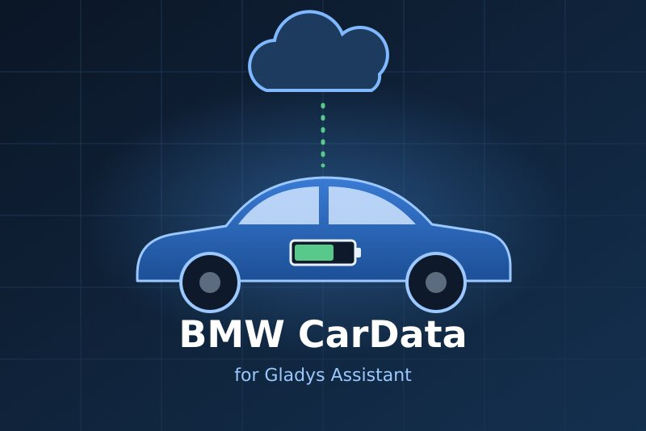
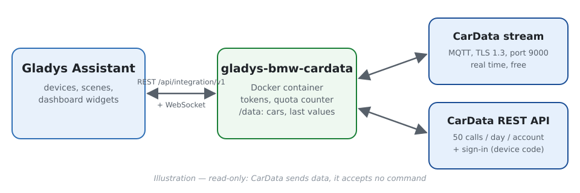
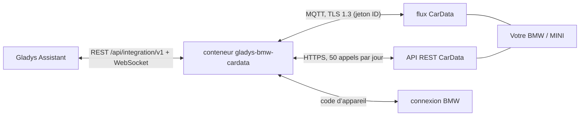
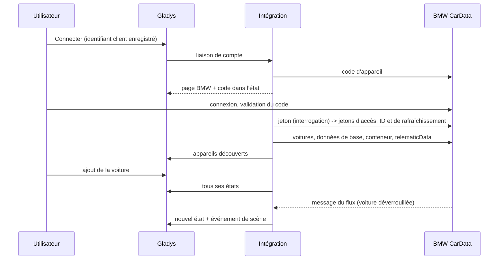
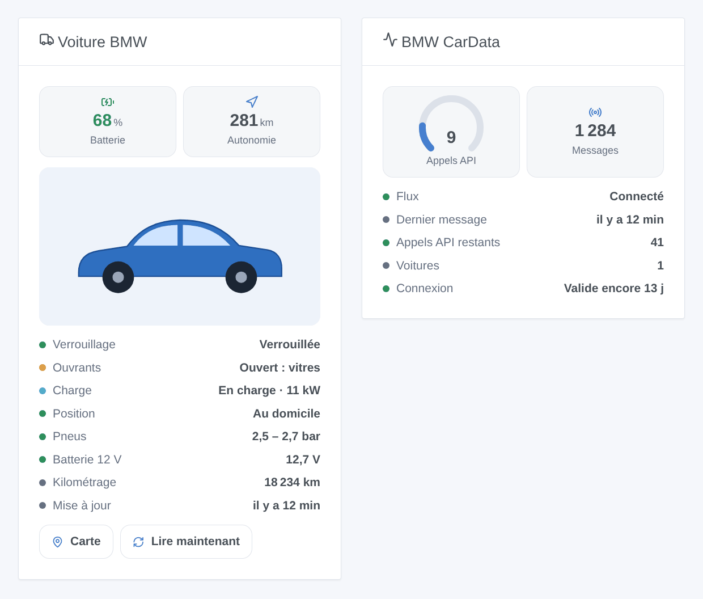

# Gladys BMW CarData

[English](README.md) · **Français** · [Deutsch](README.de.md) · [Español](README.es.md)

[](LICENSE)
[](https://github.com/William-De71/gladys-bmw-cardata/releases)
[](https://github.com/William-De71/gladys-bmw-cardata/actions/workflows/release.yml)
[](https://gladysassistant.com)



Intégration externe [Gladys Assistant](https://gladysassistant.com) pour les **voitures BMW et MINI**, via **BMW CarData**, l’accès officiel et en lecture seule de BMW aux données de votre propre voiture (Europe). Batterie, autonomie, charge, portes, verrouillage, pneus et position arrivent en quelques secondes par le flux CarData, complété par l’API REST dans la limite de ses 50 appels par jour.

Documentation utilisateur : [English](docs/en.md) · [Français](docs/fr.md) · [Deutsch](docs/de.md) · [Español](docs/es.md).

> Intégration communautaire, sans lien avec BMW Group ni approuvée par lui.

## Fonctionnalités

- Un **appareil par voiture** : batterie, autonomie électrique et totale, carburant, câble de charge, état et puissance de charge, objectif, temps restant, kilométrage, verrouillage, portes, coffre, capot, vitres, toit ouvrant, en mouvement, préclimatisation, pressions des pneus, distance du domicile.
- **Temps réel** par le flux MQTT de CarData, et **API REST** avec compteur de quota (50 appels par jour pour le compte, 5 gardés pour vos demandes).
- **7 déclencheurs de scène**, **1 action de scène** et **2 widgets** (ci-dessous).
- **Lecture seule** : CarData n’accepte aucune commande (ni verrouillage, ni climatisation, ni pilotage de la charge).
- Quatre langues partout : anglais, français, allemand, espagnol.

## Fonctionnement







### Transport

`transports: ["cloud"]` : toutes les valeurs viennent des serveurs de BMW. Les voitures portent le badge cloud ; tant que le flux est coupé, le badge affiche un point orange (mode dégradé : valeurs de l’API seulement).

## Appareils et fonctionnalités

| Fonctionnalité                                                     | Catégorie / type                                                                       | Source                                                      |
| ------------------------------------------------------------------ | -------------------------------------------------------------------------------------- | ----------------------------------------------------------- |
| Batterie (%)                                                       | `electrical-vehicle-battery` / `battery-level`                                         | `batteryManagement.header` ou `stateOfCharge.displayed`     |
| Autonomie électrique, totale (km)                                  | `electrical-vehicle-battery` / `battery-range-estimate`, `distance-sensor` / `decimal` | `remainingElectricRange`, `totalRemainingRange`             |
| Niveau de carburant (%), carburant (L)                             | `level-sensor` / `liquid-level-percent`, `volume-sensor` / `decimal`                   | `fuelSystem.level`, `fuelSystem.remainingFuel`              |
| Câble branché, en charge, état, puissance, objectif, temps restant | `electrical-vehicle-charge`, `text`, `duration`                                        | `chargingPort.status`, `charging.status`, `charging.power`… |
| Kilométrage                                                        | `electrical-vehicle-state` / `odometer`                                                | `vehicle.travelledDistance`                                 |
| Verrouillée                                                        | `electrical-vehicle-command` / `lock` (lecture seule)                                  | `cabin.door.status`, `cabin.door.lock.status`               |
| Portes, coffre, capot, vitres, toit ouvrant                        | `electrical-vehicle-state` / `door-opened`, `window-opened`                            | portes, `trunk.isOpen`, `hood.isOpen`, vitres, toit         |
| En mouvement, préclimatisation                                     | `motion-sensor` / `binary`, `electrical-vehicle-climate` / `climate-on`                | `vehicle.isMoving`, `preConditioning.activity`              |
| Pressions des pneus (bar)                                          | `electrical-vehicle-state` / `tire-pressure`                                           | `axle.row*.wheel.*.tire.pressure` (kPa)                     |
| Distance du domicile (km)                                          | `distance-sensor` / `decimal`                                                          | position et maisons de Gladys                               |

## Déclencheurs, actions de scène et widgets



- Déclencheurs : verrouillée ou déverrouillée, verrouillée mais ouverte, état de charge modifié, câble branché ou débranché, départ ou arrêt, arrivée ou départ du domicile, connexion à renouveler.
- Action : lire l’état d’une voiture (éventuellement après une lecture par l’API).
- Widgets : **Voiture BMW** (photo, tuiles, état, boutons Carte et Lire maintenant), **BMW CarData** (appels API du jour, flux, connexion).
- Exemples : verrouillée mais ouverte → message avec ce qui est ouvert ; charge terminée → notification avec le niveau de batterie ; arrivée au domicile la nuit → éclairage de l’allée.

Non implémenté : les commandes (CarData n’en a pas), les points d’accès historique de charge, diagnostic des pneus et réglages de charge par lieu (chacun coûte du quota pour peu d’usage au tableau de bord), la liste des entretiens (CBS).

## Prérequis

- Gladys **5.1.1** ou plus récent (les versions antérieures ne peuvent pas installer l’intégration : widgets et scènes).
- Une voiture BMW ou MINI en Europe, dont vous êtes l’utilisateur principal, avec ConnectedDrive.
- Un identifiant client CarData avec **les deux** abonnements (API et Stream) et un flux de données configuré (voir la [documentation](docs/fr.md#prérequis)).

## Installation

- **Depuis le store** : Intégrations → BMW CarData → Installer.
- **Depuis l’URL du dépôt** : Intégrations → Ajouter une intégration externe → `https://github.com/William-De71/gladys-bmw-cardata`.
- **Mode développeur** : `npm install`, puis lancez-la à côté d’un Gladys en mode développeur avec les variables ci-dessous.

## Configuration

| Champ                           | Par défaut                                         | Rôle                                                 |
| ------------------------------- | -------------------------------------------------- | ---------------------------------------------------- |
| Identifiant client CarData      | —                                                  | Créé dans la section CarData du portail MyBMW / MINI |
| Compte BMW                      | —                                                  | Connecter : connexion BMW par code d’appareil        |
| Hôte / port du flux             | `customer.streaming-cardata.bmwgroup.com` / `9000` | Tels qu’affichés par le portail                      |
| Lecture API toutes les (heures) | 4                                                  | 0 = seulement à la demande                           |
| Rayon du domicile (m)           | 200                                                | Arrivée / départ du domicile                         |
| Langue des textes               | Automatique                                        | Noms des fonctionnalités, résumés des scènes         |

Actions de configuration : **Tester la connexion**, **Lire les voitures maintenant**, **Diagnostic** (un résumé anonymisé dans les journaux), **Se déconnecter**.

## Utilisation

Enregistrez l’identifiant client, cliquez sur **Connecter**, validez le code sur la page BMW, puis ajoutez la voiture depuis **Découverte**. Verrouillez et déverrouillez-la une fois si aucune valeur n’arrive : une voiture endormie n’envoie rien.

## Développement

```bash
npm install
npm test                     # node --test, ne touche jamais le réseau
npm run lint && npm run format:check
npx github:GladysAssistant/integration-store . --skip-image-check
docs/illustrations/render.sh # illustrations des widgets
scripts/build-cover.sh       # cover.jpg
```

Variables d’environnement (posées par le superviseur de Gladys) : `GLADYS_HOST_API_URL`, `GLADYS_INTEGRATION_TOKEN`, `GLADYS_INTEGRATION_SELECTOR`. `CARDATA_DATA_DIR` change le dossier de données (`/data` par défaut).

## Processus de release


Chaque fusion sur `main` lance la CI, puis calcule la version depuis les [Conventional Commits](https://www.conventionalcommits.org/) depuis le dernier tag : `feat` → mineure, `fix` / `perf` → correctif, `!` ou `BREAKING CHANGE` → majeure (mineure sous 1.0.0) ; `docs`, `chore`, `ci`, `test`, `style`, `refactor`, `build` seuls ne publient rien. La section du changelog est générée, le tag poussé, l’image multi-architecture construite, puis `main` reçoit le commit de release, la GitHub Release est créée et un dernier job vérifie l’image publique, le validateur du store et le topic.

- Le titre de la pull request devient le commit squash, puis la ligne du changelog : rédigez-le en anglais, pour l’utilisateur (`pr-title.yml` le vérifie). N’éditez jamais `CHANGELOG.md` à la main.
- 1.0.0 est une décision : Actions → Release → Run workflow avec `release-as: 1.0.0`. `dry-run` affiche la version et les notes sans publier.
- **Branche protégée** : la release pousse son commit sur `main` avec `GITHUB_TOKEN`. Avec une règle sur `main`, ajoutez GitHub Actions à sa liste de contournement (ou poussez via une GitHub App), sinon le job de publication échoue.
- Après la première release, le paquet `ghcr.io` doit être public (Package settings → Change visibility).

## Dépannage

Voir [docs/fr.md](docs/fr.md#dépannage). Signalez les problèmes avec les versions de Gladys et de l’intégration, le modèle de la voiture et la sortie du bouton **Diagnostic** (Paramètres → Supervision).

## Contribuer

Tickets et pull requests bienvenus. Lancez `npm run format:check && npm run lint && npm test` avant d’ouvrir une pull request, et ne changez aucun identifiant externe ni aucune clé enregistrée (voir [CLAUDE.md](CLAUDE.md)).

## Sécurité

Voir [SECURITY.md](SECURITY.md) : signalez les vulnérabilités en privé. Les jetons sont dans la configuration de Gladys (hors formulaire), jamais journalisés ; les VIN sont raccourcis dans les journaux.

## Captures à venir

Les images ci-dessus sont des illustrations, pas des captures. Les vraies captures iront dans `docs/assets/screenshots/` (PNG, 1280 × 800) : `configuration.png`, `sign-in.png`, `discovery.png`, `device.png`.

## Licence

[Licence Apache 2.0](LICENSE) — voir aussi [NOTICE](NOTICE). BMW, MINI et CarData sont des marques de BMW AG ; cette intégration communautaire n’y est pas liée. Merci à la documentation et au SDK de Gladys, et aux intégrations CarData de Home Assistant dont l’expérience a guidé celle-ci.
