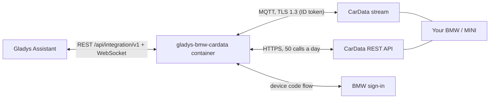
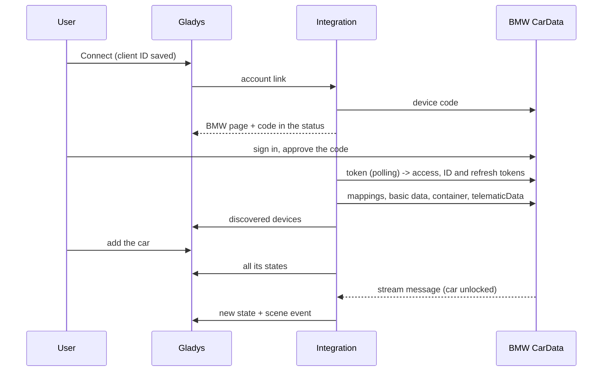
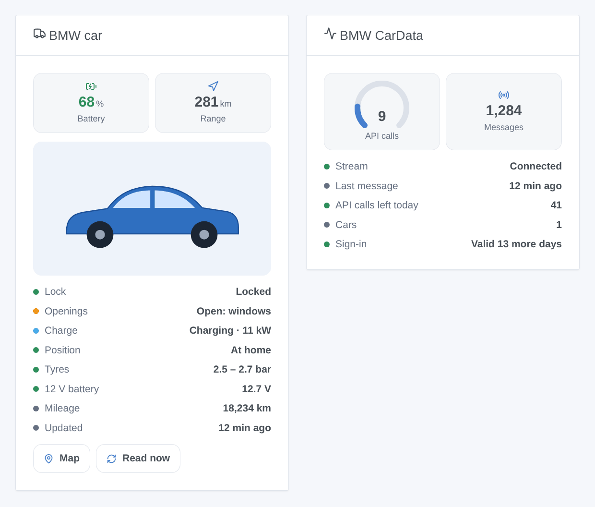

# Gladys BMW CarData

**English** · [Français](README.fr.md) · [Deutsch](README.de.md) · [Español](README.es.md)

[](LICENSE)
[](https://github.com/William-De71/gladys-bmw-cardata/releases)
[](https://github.com/William-De71/gladys-bmw-cardata/actions/workflows/release.yml)
[](https://gladysassistant.com)


[Gladys Assistant](https://gladysassistant.com) external integration for **BMW and MINI cars**, through **BMW CarData**, BMW's official and read-only access to the data of your own car (Europe). Battery, range, charge, doors, lock, tyres and position arrive within seconds through the CarData stream, completed by the REST API within its 50 calls a day.

User documentation: [English](docs/en.md) · [Français](docs/fr.md) · [Deutsch](docs/de.md) · [Español](docs/es.md).

> Community integration, not affiliated with nor endorsed by BMW Group.

## Features

- A **device per car**: battery, electric and total range, fuel, charging cable, charging status and power, charge target, time left, mileage, lock, doors, trunk, hood, windows, sunroof, driving, pre-conditioning, tyre pressures, distance from home.
- **Real time** through the CarData MQTT stream, and the **REST API** with a quota counter (50 calls a day for the account, 5 kept for your own requests).
- **7 scene triggers**, **1 scene action** and **2 dashboard widgets** (below).
- **Read-only**: CarData accepts no command (no lock, climate or charge control).
- Four languages everywhere: English, French, German, Spanish.

## How it works






### Transport

`transports: ["cloud"]`: every value comes from BMW's servers. The cars carry the cloud badge; while the stream is down the badge shows an orange dot (degraded mode: values from the API only).

## Devices and features

| Feature                                                   | Category / type                                                                        | Source                                                      |
| --------------------------------------------------------- | -------------------------------------------------------------------------------------- | ----------------------------------------------------------- |
| Battery (%)                                               | `electrical-vehicle-battery` / `battery-level`                                         | `batteryManagement.header` or `stateOfCharge.displayed`     |
| Electric range, total range (km)                          | `electrical-vehicle-battery` / `battery-range-estimate`, `distance-sensor` / `decimal` | `remainingElectricRange`, `totalRemainingRange`             |
| Fuel level (%), fuel (L)                                  | `level-sensor` / `liquid-level-percent`, `volume-sensor` / `decimal`                   | `fuelSystem.level`, `fuelSystem.remainingFuel`              |
| Cable plugged, charging, status, power, target, time left | `electrical-vehicle-charge`, `text`, `duration`                                        | `chargingPort.status`, `charging.status`, `charging.power`… |
| Mileage                                                   | `electrical-vehicle-state` / `odometer`                                                | `vehicle.travelledDistance`                                 |
| Locked                                                    | `electrical-vehicle-command` / `lock` (read-only)                                      | `cabin.door.status`, `cabin.door.lock.status`               |
| Doors, trunk, hood, windows, sunroof                      | `electrical-vehicle-state` / `door-opened`, `window-opened`                            | doors, `trunk.isOpen`, `hood.isOpen`, windows, sunroof      |
| Driving, pre-conditioning                                 | `motion-sensor` / `binary`, `electrical-vehicle-climate` / `climate-on`                | `vehicle.isMoving`, `preConditioning.activity`              |
| Tyre pressures (bar)                                      | `electrical-vehicle-state` / `tire-pressure`                                           | `axle.row*.wheel.*.tire.pressure` (kPa)                     |
| Distance from home (km)                                   | `distance-sensor` / `decimal`                                                          | position and the houses of Gladys                           |

## Scene triggers, actions and widgets



- Triggers: locked or unlocked, locked but left open, charging status changed, cable plugged or unplugged, started or stopped driving, arrived or left home, sign-in to renew.
- Action: read the status of a car (optionally after an API reading).
- Widgets: **BMW car** (picture, tiles, status, Map and Read now buttons), **BMW CarData** (API calls of the day, stream, sign-in).
- Examples: locked but left open → message with what is open; charge finished → notification with the battery level; arrived home at night → driveway lights on.

Not implemented: commands (CarData has none), the charging history, tyre diagnosis and location-based charging settings endpoints (each costs quota for little use on a dashboard), the condition-based service list.

## Requirements

- Gladys **5.1.1** or later (older versions cannot install the integration: widgets and scenes).
- A BMW or MINI car in Europe, of which you are the primary user, with ConnectedDrive.
- A CarData client ID with **both** subscriptions (API and Stream) and a configured data stream (see the [documentation](docs/en.md#prerequisites)).

## Installation

- **From the store**: Integrations → BMW CarData → Install.
- **From the repository URL**: Integrations → Add an external integration → `https://github.com/William-De71/gladys-bmw-cardata`.
- **Developer mode**: `npm install`, then run it next to a Gladys in developer mode with the variables below.

## Configuration

| Field                     | Default                                            | Purpose                                                   |
| ------------------------- | -------------------------------------------------- | --------------------------------------------------------- |
| CarData client ID         | —                                                  | Created in the CarData section of the MyBMW / MINI portal |
| BMW account               | —                                                  | Connect: BMW device code sign-in                          |
| Stream host / port        | `customer.streaming-cardata.bmwgroup.com` / `9000` | As shown by the portal                                    |
| API reading every (hours) | 4                                                  | 0 = only on request                                       |
| Home radius (m)           | 200                                                | Arrived / left home                                       |
| Language of the texts     | Automatic                                          | Feature names, scene summaries                            |

Configuration actions: **Test the connection**, **Read the cars now**, **Diagnostic** (an anonymized summary in the logs), **Disconnect**.

## Usage

Save the client ID, click **Connect**, approve the code on the BMW page, then add the car from **Discover**. Lock and unlock it once if no value arrives: a sleeping car sends nothing.

## Development

```bash
npm install
npm test                     # node --test, never touches the network
npm run lint && npm run format:check
npx github:GladysAssistant/integration-store . --skip-image-check
docs/illustrations/render.sh # widget illustrations
scripts/build-cover.sh       # cover.jpg
```

Environment variables (set by the Gladys supervisor): `GLADYS_HOST_API_URL`, `GLADYS_INTEGRATION_TOKEN`, `GLADYS_INTEGRATION_SELECTOR`. `CARDATA_DATA_DIR` changes the data directory (default `/data`).

## Release process


Every merge on `main` runs the CI, then computes the version from the [Conventional Commits](https://www.conventionalcommits.org/) since the last tag: `feat` → minor, `fix` / `perf` → patch, `!` or `BREAKING CHANGE` → major (a minor below 1.0.0); `docs`, `chore`, `ci`, `test`, `style`, `refactor`, `build` alone publish nothing. The changelog section is generated, the tag pushed, the multi-architecture image built, then `main` receives the release commit, the GitHub Release is created and a last job checks the public image, the store validator and the topic.

- The pull request title becomes the squash commit, then the changelog line: write it in English, for the user (`pr-title.yml` checks it). Never edit `CHANGELOG.md` by hand.
- 1.0.0 is a decision: Actions → Release → Run workflow with `release-as: 1.0.0`. `dry-run` shows the version and the notes without publishing.
- **Protected branch**: the release pushes its commit to `main` with `GITHUB_TOKEN`. With a ruleset on `main`, add GitHub Actions to its bypass list (or push through a GitHub App), otherwise the publish job fails.
- After the first release, the `ghcr.io` package must be public (Package settings → Change visibility).

## Troubleshooting

See [docs/en.md](docs/en.md#troubleshooting). Report issues with the versions of Gladys and of the integration, the car model, and the output of the **Diagnostic** button (Settings → Supervision).

## Contributing

Issues and pull requests are welcome. Run `npm run format:check && npm run lint && npm test` before opening a pull request, and keep every external id and stored key unchanged (see [CLAUDE.md](CLAUDE.md)).

## Security

See [SECURITY.md](SECURITY.md): report vulnerabilities privately. Tokens live in the Gladys configuration (outside the form), are never logged; VINs are shortened in the logs.

## Screenshots to come

The images above are illustrations, not screenshots. Real screenshots will go in `docs/assets/screenshots/` (PNG, 1280 × 800): `configuration.png`, `sign-in.png`, `discovery.png`, `device.png`.

## License

[Apache License 2.0](LICENSE) — see also [NOTICE](NOTICE). BMW, MINI and CarData are trademarks of BMW AG; this community integration is not affiliated with it. Thanks to the Gladys documentation and SDK, and to the Home Assistant CarData integrations whose experience shaped this one.
